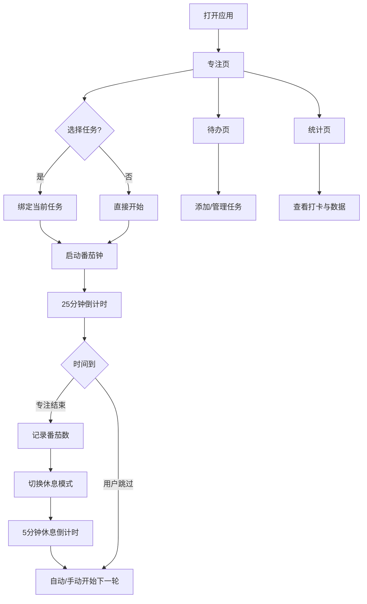

# 番茄专注 · 产品需求文档（PRD）

## 1. 产品概述

一款面向考研/学习者的极简番茄钟 + 待办清单工具，支持 PC / iPhone / iPad 多端数据同步，帮助用户通过番茄工作法保持专注并跟踪学习进度。
- 核心解决：学习时容易分心、缺乏专注节奏、进度不可视、多端数据不通的问题
- 目标用户：考研党、学生、需要深度专注的自学者
- 产品价值：打开即用，数据云端同步，用番茄数量化每日学习投入

## 2. 核心功能

### 2.1 功能模块

1. **专注页（首页）**：番茄钟倒计时、当前任务、控制按钮、白噪音开关
2. **待办页**：任务清单、添加/完成/删除任务、任务分类与优先级
3. **统计页**：每日番茄数、专注时长、打卡日历、任务完成率
4. **数据同步**：后端 SQLite 存储，多端通过 API 实时同步任务与番茄记录

### 2.2 页面详情

| 页面名称 | 模块名称 | 功能描述 |
|----------|----------|----------|
| 专注页 | 番茄钟 | 25分钟专注/5分钟休息倒计时，可自定义时长，支持开始/暂停/重置/跳过 |
| 专注页 | 当前任务 | 显示正在进行的任务，快速切换到下一个任务 |
| 专注页 | 控制区 | 开始/暂停按钮、重置、跳过、模式切换（专注/短休息/长休息） |
| 专注页 | 白噪音 | 内置雨声/咖啡馆/白噪音等环境音，开关切换 |
| 待办页 | 任务列表 | 按「待办/已完成」分组，显示任务名、番茄估算、分类标签 |
| 待办页 | 添加任务 | 输入任务名、选择分类（学习/英语/政治/数学/其他）、优先级 |
| 待办页 | 任务操作 | 勾选完成、编辑、删除、设置番茄数 |
| 统计页 | 今日数据 | 今日番茄数、专注总时长、完成任务数 |
| 统计页 | 打卡日历 | 热力图展示最近30天每日番茄数 |
| 统计页 | 任务完成率 | 已完成/未完成任务比例 |

## 3. 核心流程

用户打开应用 → 进入专注页 → 从待办中选择任务或直接开始 → 番茄钟倒计时 → 时间到自动切换休息 → 记录一次番茄 → 统计页实时更新数据

## 4. 用户界面设计

### 4.1 设计风格

- **主色调**：番茄红 `#FF5A4F` 作为强调色，搭配深灰近黑背景 `#1A1A1E`，营造专注沉稳的氛围
- **辅助色**：休息模式用薄荷绿 `#4ADE80`，已完成任务用灰色
- **按钮风格**：大圆角胶囊按钮，主按钮为实心番茄红，次按钮为半透明边框
- **字体**：使用系统中文字体栈，数字倒计时用等宽字体（JetBrains Mono 类），数字大而醒目
- **布局风格**：单栏居中，移动端优先；底部分 Tab 导航（专注/待办/统计）
- **图标风格**：简洁线性图标，配合少量 emoji 增强识别

### 4.2 页面设计概览

| 页面名称 | 模块名称 | UI 元素 |
|----------|----------|---------|
| 专注页 | 番茄钟 | 居中大号倒计时数字、环形进度条、脉冲动画 |
| 专注页 | 控制区 | 胶囊形主按钮、模式切换标签、白噪音开关 |
| 待办页 | 任务列表 | 卡片式列表、分类色标、勾选动画 |
| 待办页 | 添加栏 | 底部固定输入栏、分类选择器 |
| 统计页 | 今日数据 | 大数字卡片、番茄图标 |
| 统计页 | 打卡日历 | 7列热力图格子、深浅表示番茄数 |

### 4.3 响应式

- 移动端优先设计，最大宽度 480px 居中
- 桌面端居中显示，两侧留白
- 触摸优化：按钮最小 44px，列表项足够大便于点击
