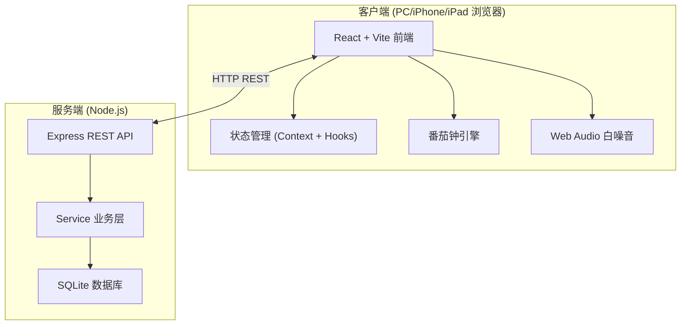
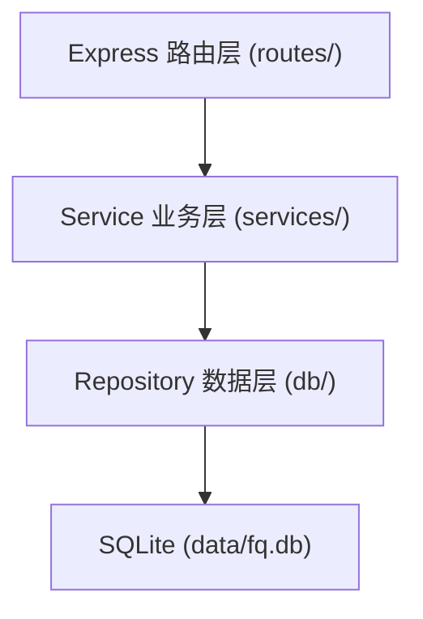
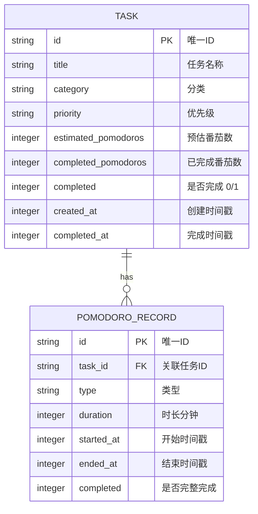

# 番茄专注 · 技术架构文档

## 1. 架构设计

前后端分离架构。前端 React SPA，后端 Node.js + Express + SQLite，提供 REST API 实现多端数据同步。前端通过 API 与后端通信，数据持久化在服务端 SQLite 数据库，PC / iPhone / iPad 任意设备打开浏览器访问同一服务即可同步。



## 2. 技术选型

- **前端**：React@18 + TypeScript + TailwindCSS@3
- **构建工具**：Vite
- **路由**：useState 页面切换（专注/待办/统计），不引入路由库
- **状态管理**：React Hooks + Context
- **HTTP 客户端**：原生 fetch（封装）
- **图标**：Lucide React
- **后端**：Node.js + Express@4
- **数据库**：SQLite（better-sqlite3，同步 API，零配置）
- **白噪音**：Web Audio API 在客户端生成
- **CORS**：配置允许跨域，便于开发与多端访问

## 3. 页面/视图定义

| 视图 | 用途 |
|------|------|
| Focus | 专注页：番茄钟倒计时与控制 |
| Todo | 待办页：任务管理 |
| Stats | 统计页：数据与打卡日历 |

## 4. API 定义

基础路径：`/api`

### 4.1 任务相关

| 方法 | 路径 | 说明 |
|------|------|------|
| GET | `/tasks` | 获取所有任务 |
| POST | `/tasks` | 创建任务 |
| PUT | `/tasks/:id` | 更新任务 |
| DELETE | `/tasks/:id` | 删除任务 |
| PATCH | `/tasks/:id/toggle` | 切换任务完成状态 |
| PATCH | `/tasks/:id/pomodoro` | 任务已完成番茄数 +1 |

**Task 类型：**
```ts
interface Task {
  id: string;
  title: string;
  category: 'study' | 'english' | 'politics' | 'math' | 'other';
  priority: 'high' | 'medium' | 'low';
  estimatedPomodoros: number;
  completedPomodoros: number;
  completed: boolean;
  createdAt: number;
  completedAt: number | null;
}
```

### 4.2 番茄记录相关

| 方法 | 路径 | 说明 |
|------|------|------|
| GET | `/records` | 获取所有番茄记录（可按日期过滤） |
| POST | `/records` | 创建一条番茄记录 |

**Record 类型：**
```ts
interface PomodoroRecord {
  id: string;
  taskId: string | null;
  type: 'focus' | 'shortBreak' | 'longBreak';
  duration: number; // 分钟
  startedAt: number;
  endedAt: number;
  completed: boolean;
}
```

### 4.3 统计相关

| 方法 | 路径 | 说明 |
|------|------|------|
| GET | `/stats/today` | 今日番茄数、专注时长、完成任务数 |
| GET | `/stats/daily?days=30` | 最近 N 天每日番茄数（热力图） |

## 5. 服务端架构



目录结构：
```
server/
├── index.ts              # 入口，启动 Express
├── db.ts                 # better-sqlite3 初始化 + 建表
├── routes/
│   ├── tasks.ts
│   ├── records.ts
│   └── stats.ts
├── services/
│   ├── taskService.ts
│   ├── recordService.ts
│   └── statsService.ts
└── data/
    └── fq.db             # SQLite 数据库文件
```

## 6. 数据模型

### 6.1 ER 图



### 6.2 DDL

```sql
CREATE TABLE IF NOT EXISTS tasks (
  id TEXT PRIMARY KEY,
  title TEXT NOT NULL,
  category TEXT NOT NULL DEFAULT 'study',
  priority TEXT NOT NULL DEFAULT 'medium',
  estimated_pomodoros INTEGER NOT NULL DEFAULT 1,
  completed_pomodoros INTEGER NOT NULL DEFAULT 0,
  completed INTEGER NOT NULL DEFAULT 0,
  created_at INTEGER NOT NULL,
  completed_at INTEGER
);

CREATE TABLE IF NOT EXISTS pomodoro_records (
  id TEXT PRIMARY KEY,
  task_id TEXT,
  type TEXT NOT NULL,
  duration INTEGER NOT NULL,
  started_at INTEGER NOT NULL,
  ended_at INTEGER NOT NULL,
  completed INTEGER NOT NULL DEFAULT 1,
  FOREIGN KEY (task_id) REFERENCES tasks(id) ON DELETE SET NULL
);

CREATE INDEX IF NOT EXISTS idx_records_started_at ON pomodoro_records(started_at);
CREATE INDEX IF NOT EXISTS idx_tasks_completed ON tasks(completed);
```

## 7. 核心组件结构

```
src/
├── App.tsx                 # 根组件，页面切换 + 数据加载
├── main.tsx
├── index.css
├── types/
│   └── index.ts
├── api/
│   ├── client.ts           # fetch 封装
│   ├── tasks.ts            # 任务 API
│   ├── records.ts          # 记录 API
│   └── stats.ts            # 统计 API
├── hooks/
│   ├── useTimer.ts         # 番茄钟计时逻辑
│   └── useApi.ts           # 通用请求
├── contexts/
│   ├── TaskContext.tsx     # 任务数据 + CRUD
│   └── TimerContext.tsx    # 计时器
├── components/
│   ├── layout/
│   │   └── TabBar.tsx
│   ├── focus/
│   │   ├── TimerDisplay.tsx
│   │   ├── TimerControls.tsx
│   │   ├── ModeSwitcher.tsx
│   │   └── CurrentTask.tsx
│   ├── todo/
│   │   ├── TaskList.tsx
│   │   ├── TaskItem.tsx
│   │   └── AddTaskForm.tsx
│   ├── stats/
│   │   ├── TodaySummary.tsx
│   │   └── HeatmapCalendar.tsx
│   └── common/
│       └── WhiteNoise.tsx
└── utils/
    ├── audio.ts
    └── date.ts
```

## 8. 番茄钟逻辑规则

- 默认：专注 25 分钟 → 短休息 5 分钟；每 4 个专注后长休息 15 分钟
- 倒计时用 `setInterval`，每秒更新，结束时调用 `POST /records` 写入记录
- 若绑定了任务，同时调用 `PATCH /tasks/:id/pomodoro` 使该任务 completedPomodoros +1
- 模式切换时重置计时
- 前端不持久化计时状态到服务端（计时是本地行为），仅记录完成的番茄到服务端
- 多端同时打开时，任务数据通过 API 实时拉取；番茄记录互相可见

## 9. 启动方式

- 开发：`npm run dev` 同时启动前端 Vite (5173) 与后端 Express (3001)
- 前端通过代理或直接请求后端 API
- 同局域网设备访问：PC 局域网 IP:端口 即可在 iPhone/iPad 浏览器打开
